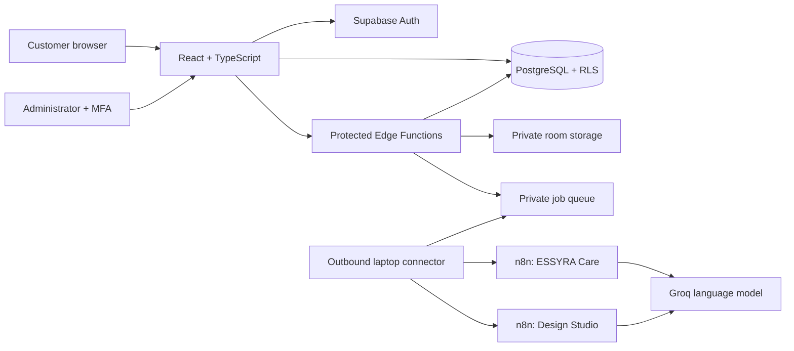

<div align="center">

# ESSYRA
### Find the soul of your place.

A furniture shopping experience with a private design workspace, conversational assistance, and store administration.

[](https://essyra-home.vercel.app/)
[](https://github.com/ibreeqzafar/dbms/actions/workflows/checks.yml)


[Explore the store](https://essyra-home.vercel.app/) · [Design Studio](https://essyra-home.vercel.app/studio) · [Setup guide](SETUP.md) · [Agent architecture](DESIGN-AGENT.md)


**Created by Umamah Ibreeq · Founder & CEO**

</div>

---

## A home, considered from every angle

ESSYRA connects furniture discovery with interior inspiration. Customers browse by room, compare pieces, create a room composition and place cash-on-delivery orders. A private administration area gives the brand control over its catalogue, stock, sale prices, orders and customer care.

Built as a university DBMS project, it brings the interface, relational data model, access rules and automation workflows together in one repository.

## Explore the experience

| Experience | What it includes |
|---|---|
| **Furniture discovery** | Room and item categories, search, price and material filters, sorting, product details, favourites and comparison. |
| **Design Studio** | Preferences, budget and placement constraints; catalogue matching; furniture cutouts; adjustable room compositions and private saved designs. |
| **ESSYRA Care** | Shopping questions, catalogue searches, product comparisons, policy guidance and links to authenticated order/support tools. |
| **Customer accounts** | Email/password and configured Google sign-in, password recovery, owned orders and delivered-purchase reviews. |
| **Store administration** | Products, inventory, sale prices, orders, customer records and reports, protected by administrator permissions and MFA. |
| **Presentation** | Light/dark themes, responsive layouts, cinematic interiors, breadcrumbs, page metadata, sitemap and social previews. |

### Agent status

| Component | Current implementation |
|---|---|
| **ESSYRA Care** | Local n8n workflow using Groq `openai/gpt-oss-20b` and bounded public catalogue/policy tools. |
| **Design Studio adviser** | Separate n8n workflow and conversation memory; styling guidance for the studio's matched products. |
| **Furniture placement** | Browser-based background removal, cropping and adjustable illustrative overlays. |
| **Photorealistic room editing** | Local n8n room-validation and FLUX image tests passed. The private website queue and separate finished-image panel are prepared; production activation is pending. [Integration notes](DESIGN-STUDIO-IMAGES.md). |

Self-hosted n8n Community Edition does not depend on the n8n Cloud trial. Both n8n and the connector must run on an awake, connected laptop. Groq and any image service have their own limits.

## How the pieces connect



The frontend is hosted on Vercel. Supabase hosts authentication, live database records, private files and backend functions. GitHub stores source code and database setup files. The laptop stores n8n's private runtime and encrypted credentials.

## Run locally

**Requirements:** Node.js 24, npm and a configured Supabase project for connected features.

```bash
git clone https://github.com/ibreeqzafar/dbms.git
cd dbms
npm ci
```

Copy `.env.example` to `.env.local`, then configure the public project URL, publishable key, site URL and feature flags.

```bash
npm run dev
```

Development runs at `http://127.0.0.1:4174`. Create the production build with:

```bash
npm run build
```

The build produces `dist/`, generates public SEO routes, splits large features into separate chunks and disables production source maps.

### Start the local agents

For the existing configured laptop installation, double-click **Start ESSYRA Support.cmd** in the `essyra-n8n-local` setup folder. This starts n8n and the outbound website connector. Open `http://localhost:5678` to inspect workflows.

For a fresh installation from GitHub:

```bash
cd local-n8n
npm ci
npm start
```

Follow [local n8n setup](local-n8n/README.md), import the workflows in `n8n/`, select your own saved provider credentials, and configure the connector. Importing portable JSON alone does not install credentials or activate the website connection.

## Project map

```text
src/                    Frontend pages, components and application logic
public/                 Brand assets, interior film and original layout model
supabase/
  functions/            Backend function source and shared validation
  migrations/           Database schema, policies and incremental changes
  seed.sql              Catalogue initialization
n8n/                    Portable Care and Design Studio workflow definitions
local-n8n/              Laptop launchers, connector and dependency lockfile
scripts/                Builds, catalogue utilities and regression checks
specifications/         SRS and SDS text
.github/                Automated checks and dependency-update configuration
```

## Validate the project

| Command | Coverage |
|---|---|
| `npm test` | Domain rules, catalogue consistency, navigation, chat formatting and rankings. |
| `npm run test:database` | Database migrations, checkout, stock, idempotency and ownership. |
| `npm run test:admin` | Administrator MFA, role boundaries, sale prices and reporting. |
| `npm run test:studio` | Image handling, matching, private image-job permissions, leases and request limits. |
| `npm run test:support` | Chat isolation, worker leases, tickets and public ranking projections. |
| `npm run test:reviews` | Delivered-purchase reviews, privacy and invitation queues. |
| `node scripts/support-workflow-check.mjs` | Fixed read-only endpoints and portable workflow boundaries. |
| `npm run build` | Type checking, production assets and generated SEO routes. |

Database tests use disposable local PostgreSQL fixtures. Passing tests is evidence for the tested controls, not an exhaustive security guarantee. Dependencies in the local automation environment require separate review and updates.

## Deployment

| Vercel setting | Value |
|---|---|
| Project | `essyra-home` |
| Framework | Vite |
| Node.js | 24.x |
| Root directory | Repository root |
| Install command | `npm ci` |
| Build command | `npm run build` |
| Output directory | `dist` |

Set the public variables from `.env.example` in Vercel. To enable deployments on push, connect the repository to the existing Vercel project using the owner's GitHub Login Connection. Source upload is complete; that account-linking step was still pending at the last verified check.

Backend functions and database migrations are deployed separately. Supabase's automatic production deployment was off at the last check. Reconcile the manually installed migration history before enabling it; do not blindly rerun historical migrations against the existing database.

## Data and privacy

- Private customer records, room photos, credentials and n8n runtime backups do not belong in GitHub.
- Only public configuration belongs in `VITE_*` variables. Provider and service-role keys remain in secure server or n8n settings.
- Customer access is enforced by database ownership rules; staff management requires an active administrator with MFA.
- Guest recommendation access uses three successful generations with a 24-hour refill. Failed/empty matching requests do not consume a successful generation.
- Reference product media and historical project records are documented in [REFERENCE_DATA.md](REFERENCE_DATA.md). Confirm media rights and replace project records before real commercial use.
- COD is the current payment method. The project's delivery scheduler simulates delivery status; it does not verify a physical courier.

## Useful guides

[General setup](SETUP.md) · [Administrator guide](ADMIN-GUIDE.md) · [Design agent](DESIGN-AGENT.md) · [Support connection](SUPPORT-AGENT-SETUP.md) · [Customer reviews](CUSTOMER-REVIEWS.md) · [Furniture cutouts](STUDIO-EXTRACTION.md)

---

<div align="center">

**ESSYRA · Find the soul of your place.**

[essyra.furniture@gmail.com](mailto:essyra.furniture@gmail.com) · [+92 317 2197499](tel:+923172197499)

</div>
